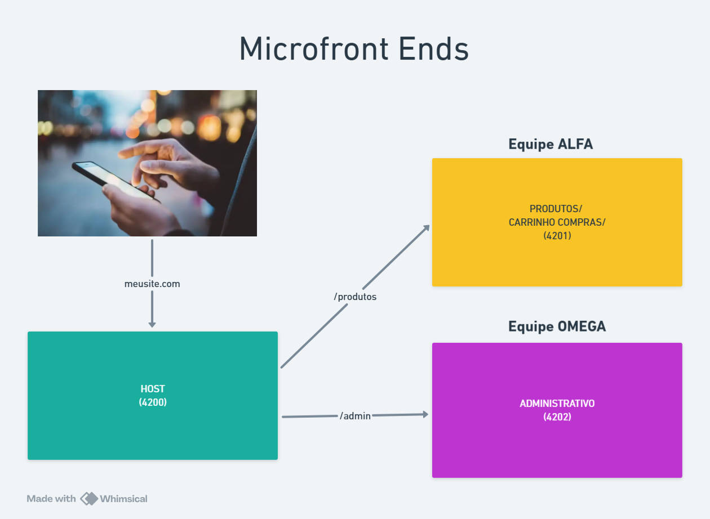

# 🧩 Microfrontends com Angular

Aplicação de estudo que demonstra como dividir uma experiência de e-commerce em microfrontends Angular independentes e integrá-los no navegador com **Native Federation**.

## 🎯 Visão geral

O projeto simula uma pequena loja virtual composta por três aplicações:

- **Vendas**: host da solução. Exibe a navegação e carrega os microfrontends remotos por rota.
- **Produtos**: remote responsável pelo catálogo de produtos e pelo componente de carrinho.
- **Gráfico**: remote responsável pelo dashboard visual de vendas por categoria.

O host usa `loadRemoteModule` para buscar os módulos expostos pelos remotes. Assim, cada aplicação pode ser desenvolvida, compilada e executada de forma independente, enquanto a experiência final permanece integrada.

## 🎓 O que aprendemos neste projeto

- 🧱 Como separar uma aplicação Angular em host e remotes.
- 🔗 Como configurar Native Federation com `@angular-architects/native-federation`.
- 🚪 Como expor componentes usando `federation.config.mjs`.
- 🧭 Como carregar componentes remotos sob demanda nas rotas do host.
- 📦 Como compartilhar dependências Angular como singletons com versões estritas.
- 📊 Como criar um gráfico de barras com Chart.js.
- 🎨 Como organizar templates, estilos SCSS, rotas e testes por microfrontend.
- 🛠️ Como executar e validar cada aplicação isoladamente.

## 🛠️ Tecnologias utilizadas

| Tecnologia | Uso |
| --- | --- |
| Angular 22 | Framework das aplicações |
| TypeScript 6 | Tipagem e desenvolvimento |
| Native Federation | Integração entre host e remotes |
| Angular CLI | Desenvolvimento, build e testes |
| RxJS | Infraestrutura reativa do Angular |
| Chart.js 4 | Gráfico de vendas |
| SCSS | Estilização |
| Vitest | Testes unitários |
| npm 11 | Gerenciamento de dependências |

## 📋 Pré-requisitos e dependências

- **Node.js** compatível com Angular 22.
- **npm 11.17.0** ou versão compatível.
- Navegador moderno com suporte a JavaScript modules.
- Dependências instaladas em cada uma das três pastas. Este repositório mantém um `package.json` e um `package-lock.json` por aplicação.

## 🚀 Como executar

### 📥 1. Clonar o repositório

```bash
git clone https://github.com/marcionavarro/udemy-angular19.git
cd udemy-angular19/microfront-ends
```

### 📦 2. Instalar as dependências

Execute em cada aplicação:

```bash
cd vendas
npm install

cd ../produtos
npm install

cd ../grafico
npm install
```

### ▶️ 3. Iniciar os microfrontends

Abra três terminais, todos na pasta `microfront-ends`, e execute:

```bash
cd vendas
npm start
```

```bash
cd produtos
npm start
```

```bash
cd grafico
npm start
```

Portas configuradas:

| Aplicação | Tipo | Endereço |
| --- | --- | --- |
| Vendas | Host | [http://localhost:4200](http://localhost:4200) |
| Produtos | Remote | [http://localhost:4201](http://localhost:4201) |
| Gráfico | Remote | [http://localhost:4202](http://localhost:4202) |

> ▶️ Inicie os remotes antes de navegar pelas rotas `produtos`, `carrinho` e `grafico` no host.

### 🧪 4. Compilar e testar

Em qualquer aplicação:

```bash
npm run build
npm test
```

Para desenvolvimento com recompilação automática:

```bash
npm run watch
```

## 📸 Screenshots



> 🖼️ A imagem de referência da arquitetura está em [`docs/MicrofrontEnds.png`](docs/MicrofrontEnds.png).

## 📁 Estrutura de diretórios

```text
microfront-ends/
├── vendas/                 # Host e navegação principal
│   ├── src/app/home/       # Tela inicial
│   ├── src/app/navbar/     # Navegação do host
│   └── federation.config.mjs
├── produtos/               # Remote de catálogo e carrinho
│   ├── src/app/carrinho/   # Componente exposto do carrinho
│   └── federation.config.mjs
├── grafico/                # Remote do dashboard de vendas
│   └── federation.config.mjs
└── docs/                   # Imagens e links de apoio
```

### 🔌 Exposes e rotas

| Remote | Expose | Consumido pelo host em |
| --- | --- | --- |
| `produtos` | `./Component` | `/produtos` |
| `produtos` | `./Carrinho` | `/carrinho` |
| `grafico` | `./Component` | `/grafico` |

## 📚 Recursos e links úteis

- 📘 [Documentação do Angular](https://angular.dev/)
- 🧰 [Angular CLI](https://angular.dev/tools/cli)
- 🔗 [Module Federation](https://module-federation.io/)
- 🧩 [Angular Architects Native Federation](https://www.npmjs.com/package/@angular-architects/native-federation)
- 📊 [Chart.js](https://www.chartjs.org/docs/latest/)
- 🧪 [Vitest](https://vitest.dev/)
- 🐙 [Repositório no GitHub](https://github.com/marcionavarro/udemy-angular19)

## 📄 Licença

Projeto educacional desenvolvido para acompanhar estudos de Angular e arquitetura de microfrontends.
