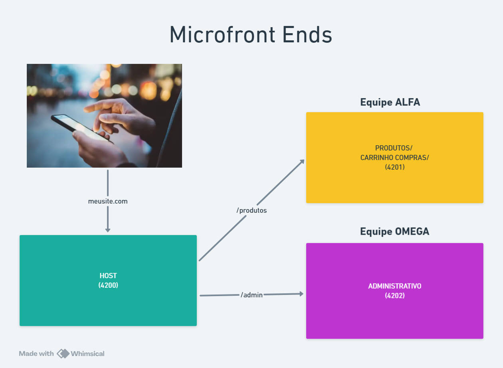

# 📊 Gráfico — Remote

Microfrontend responsável por apresentar um dashboard de vendas. Ele cria um gráfico de barras com dados demonstrativos e expõe o componente para ser carregado pelo host `vendas`.

## 🎯 Responsabilidade

- 📈 Renderizar vendas agrupadas por categoria.
- 🧮 Transformar categorias e valores em datasets do gráfico.
- 🔌 Expor o dashboard como componente remoto.
- 📱 Usar o modo responsivo do Chart.js.

## 🔌 Componente exposto

| Expose | Arquivo | Uso no host |
| --- | --- | --- |
| `./Component` | `src/app/app.ts` | Dashboard em `/grafico` |

O gráfico utiliza as categorias Eletrônicos, Roupas, Decoração, Ferramentas e Acessórios com dados locais de demonstração.

## 🛠️ Tecnologias

| Tecnologia | Finalidade |
| --- | --- |
| Angular 22 | Componente do dashboard |
| Native Federation | Exposição do remote |
| Chart.js 4 | Gráfico de barras |
| TypeScript 6 | Lógica e tipagem |
| SCSS | Estilos responsivos |
| Vitest | Testes unitários |

## 📋 Pré-requisitos

- Node.js compatível com Angular 22.
- npm 11.17.0 ou compatível.
- Dependências instaladas nesta pasta.

## 🚀 Executar

```bash
cd grafico
npm install
npm start
```

Acesse [http://localhost:4202](http://localhost:4202). Para navegar pelo dashboard a partir da aplicação integrada, execute também o host `vendas`.

## 🧪 Build e testes

```bash
npm run build
npm test
npm run watch
```

## 📸 Screenshot



## 📁 Estrutura

```text
grafico/
├── src/app/app.ts          # Configuração e criação do Chart.js
├── src/app/app.html        # Canvas do gráfico
├── src/app/app.scss        # Layout do dashboard
├── federation.config.mjs   # Expose do componente
└── package.json            # Scripts e dependências
```

## 📚 Recursos

- 📘 [Angular](https://angular.dev/)
- 📊 [Chart.js](https://www.chartjs.org/docs/latest/)
- 🔗 [Native Federation](https://www.npmjs.com/package/@angular-architects/native-federation)
