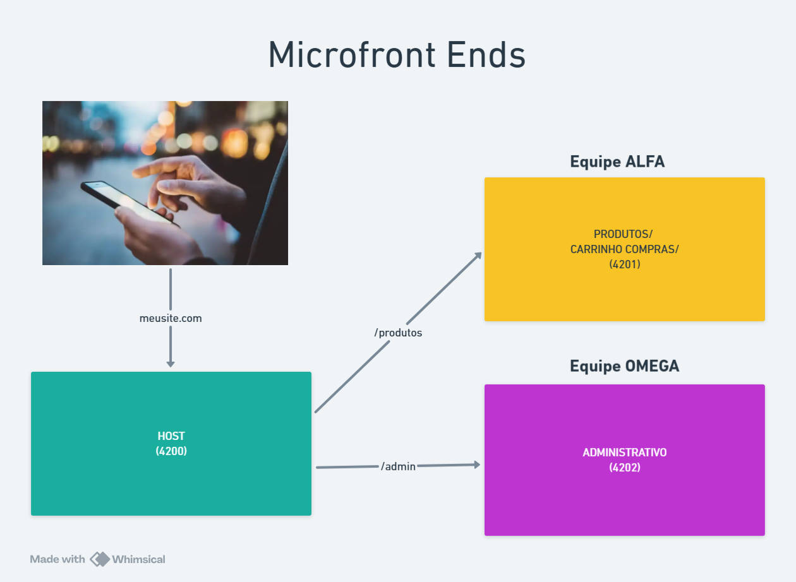

# 📦 Produtos — Remote

Microfrontend responsável pelo catálogo de produtos da loja e pelo componente de carrinho. A aplicação pode ser executada sozinha, mas foi projetada para ser carregada pelo host `vendas`.

## 🎯 Responsabilidade

- 🛍️ Exibir a lista de produtos.
- 💰 Formatá-los em reais usando `CurrencyPipe`.
- 🛒 Disponibilizar o componente de carrinho.
- 🔌 Expor componentes para consumo via Native Federation.

## 🔌 Componentes expostos

Configurados em `federation.config.mjs`:

| Expose | Arquivo | Uso no host |
| --- | --- | --- |
| `./Component` | `src/app/app.ts` | Catálogo em `/produtos` |
| `./Carrinho` | `src/app/carrinho/carrinho.ts` | Carrinho em `/carrinho` |

O catálogo usa dados locais de demonstração e imagens remotas do serviço Picsum.

## 🛠️ Tecnologias

| Tecnologia | Finalidade |
| --- | --- |
| Angular 22 | Interface do catálogo |
| Native Federation | Exposição dos componentes |
| TypeScript 6 | Modelagem e lógica |
| Angular CurrencyPipe | Formatação de preços |
| SCSS | Estilos |
| Vitest | Testes unitários |

## 📋 Pré-requisitos

- Node.js compatível com Angular 22.
- npm 11.17.0 ou compatível.
- Dependências instaladas nesta pasta.

## 🚀 Executar

```bash
cd produtos
npm install
npm start
```

Acesse [http://localhost:4201](http://localhost:4201). Para visualizar o catálogo dentro da experiência integrada, mantenha também o host `vendas` em execução.

## 🧪 Build e testes

```bash
npm run build
npm test
npm run watch
```

## 📸 Screenshot



## 📁 Estrutura

```text
produtos/
├── src/app/app.ts          # Catálogo exposto como ./Component
├── src/app/app.html        # Cards de produtos
├── src/app/carrinho/       # Componente exposto como ./Carrinho
├── federation.config.mjs   # Exposes e dependências compartilhadas
└── package.json            # Scripts e dependências
```

## 📚 Recursos

- 📘 [Angular](https://angular.dev/)
- 🔗 [Native Federation](https://www.npmjs.com/package/@angular-architects/native-federation)
- 💱 [Angular CurrencyPipe](https://angular.dev/api/common/CurrencyPipe)
