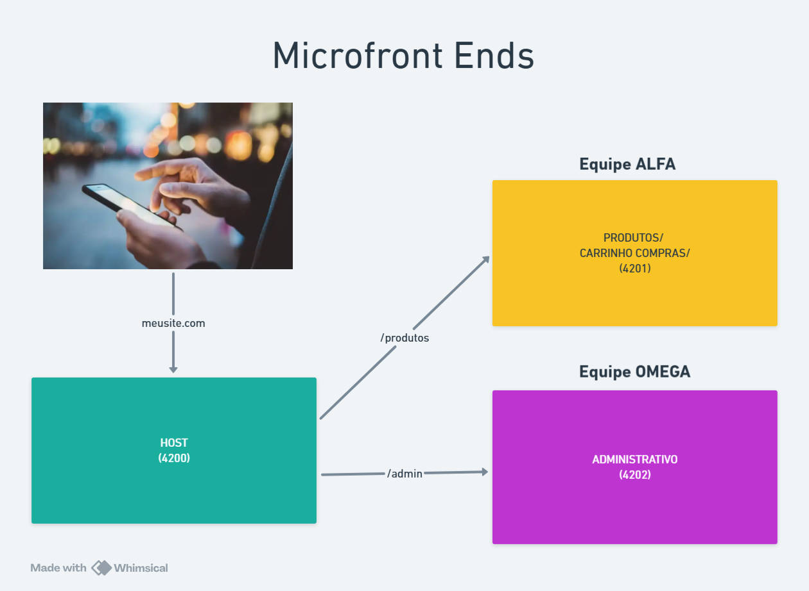

# 🛒 Vendas — Host

Aplicação host do projeto de microfrontends. Ela fornece a navegação principal, a tela inicial e integra os componentes remotos de produtos e gráfico usando Native Federation.

## 🎯 Responsabilidade

- 🏠 Exibir a página inicial da loja.
- 🧭 Fornecer a barra de navegação.
- 🔌 Carregar os remotes `produtos` e `grafico` sob demanda.
- 🛣️ Disponibilizar as rotas `/produtos`, `/carrinho` e `/grafico`.

## 🧩 Integração com remotes

As rotas em `src/app/app.routes.ts` usam `loadRemoteModule`:

| Rota | Remote | Expose |
| --- | --- | --- |
| `/produtos` | `produtos` | `./Component` |
| `/carrinho` | `produtos` | `./Carrinho` |
| `/grafico` | `grafico` | `./Component` |

Os remotes precisam estar disponíveis nas portas 4201 e 4202 para que essas rotas sejam carregadas.

## 🛠️ Tecnologias

| Tecnologia | Finalidade |
| --- | --- |
| Angular 22 | Aplicação host |
| TypeScript 6 | Código da aplicação |
| Native Federation | Carregamento de componentes remotos |
| SCSS | Estilos |
| Vitest | Testes unitários |

## 📋 Pré-requisitos

- Node.js compatível com Angular 22.
- npm 11.17.0 ou compatível.
- Dependências dos três projetos instaladas.

## 🚀 Executar

```bash
cd vendas
npm install
npm start
```

Acesse [http://localhost:4200](http://localhost:4200). Para a integração completa, execute também:

```bash
cd ../produtos && npm start
cd ../grafico && npm start
```

> 💡 Em terminais separados, os comandos dos remotes devem permanecer ativos.

## 🧪 Build e testes

```bash
npm run build
npm test
npm run watch
```

## 📸 Screenshot



## 📁 Estrutura

```text
vendas/
├── src/app/home/            # Tela inicial
├── src/app/navbar/          # Barra de navegação
├── src/app/app.routes.ts    # Rotas locais e remotas
├── src/app/app.config.ts    # Configuração do Angular
├── federation.config.mjs    # Configuração do host
└── package.json             # Scripts e dependências
```

## 📚 Recursos

- 📘 [Angular](https://angular.dev/)
- 🔗 [Native Federation](https://www.npmjs.com/package/@angular-architects/native-federation)
- 🧩 [Module Federation](https://module-federation.io/)
